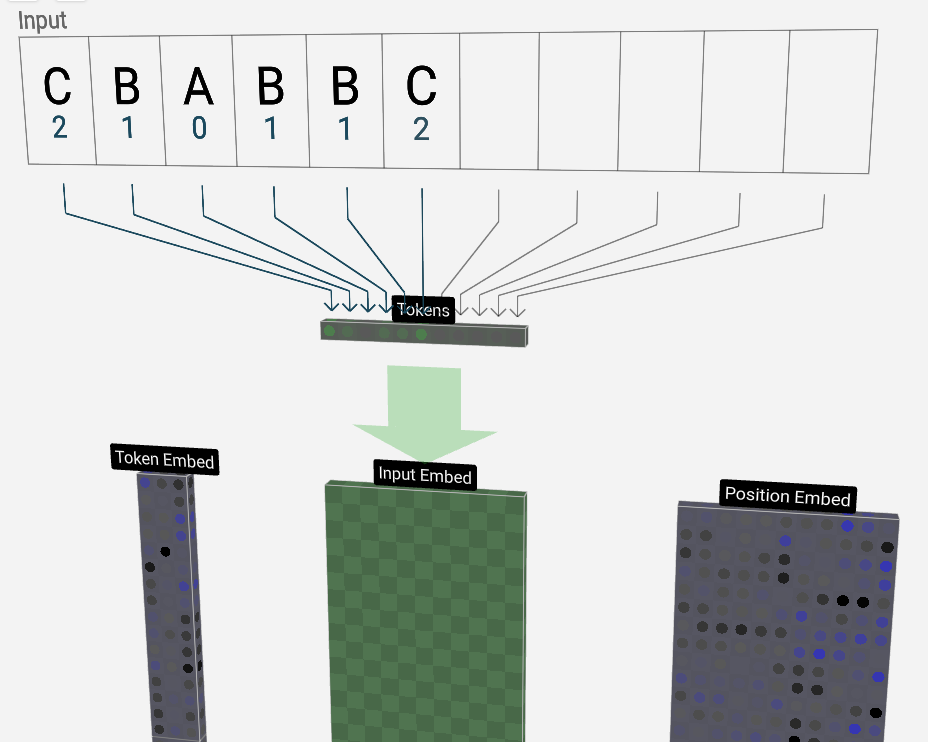

- Запросы на английском будут дешевле обходиться ?
- У нас 6 токенов, почему input embed стоит из 11 колонок ?
-  я понимаю, что input embed это полученные токены, что token embed это вес под каждый input embed, я не понимаю, как расставляется position embed и для чего
- Насколько глубоко нужно понимать как устроены и работают embedding и transformer для моего направления изучения
